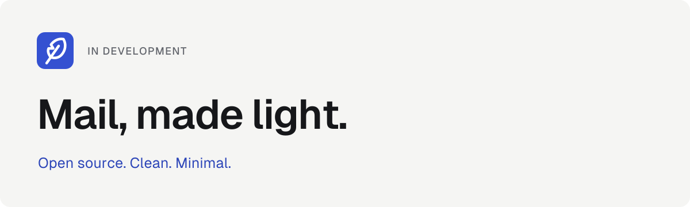
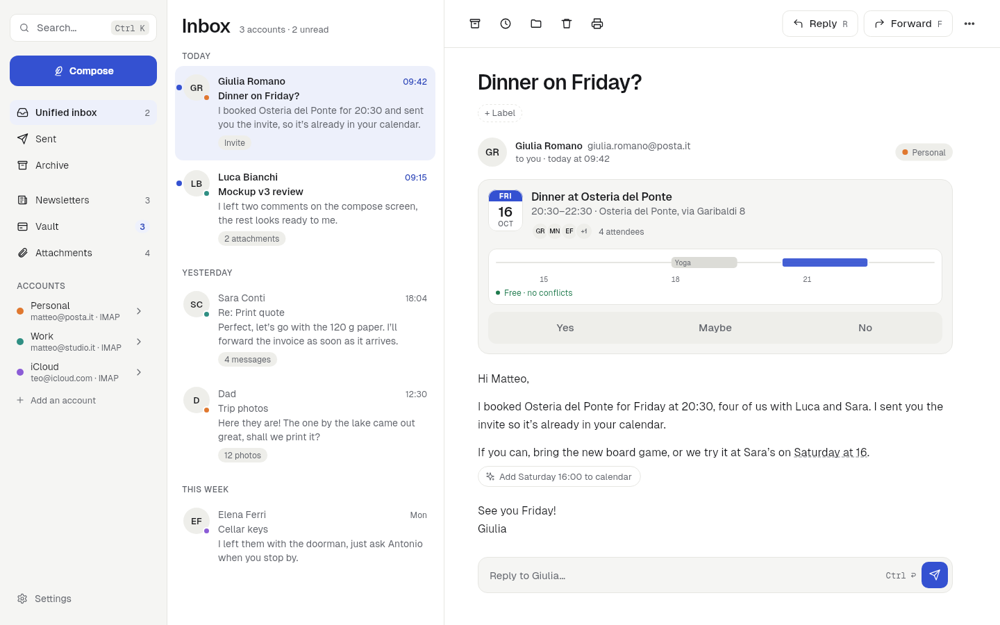
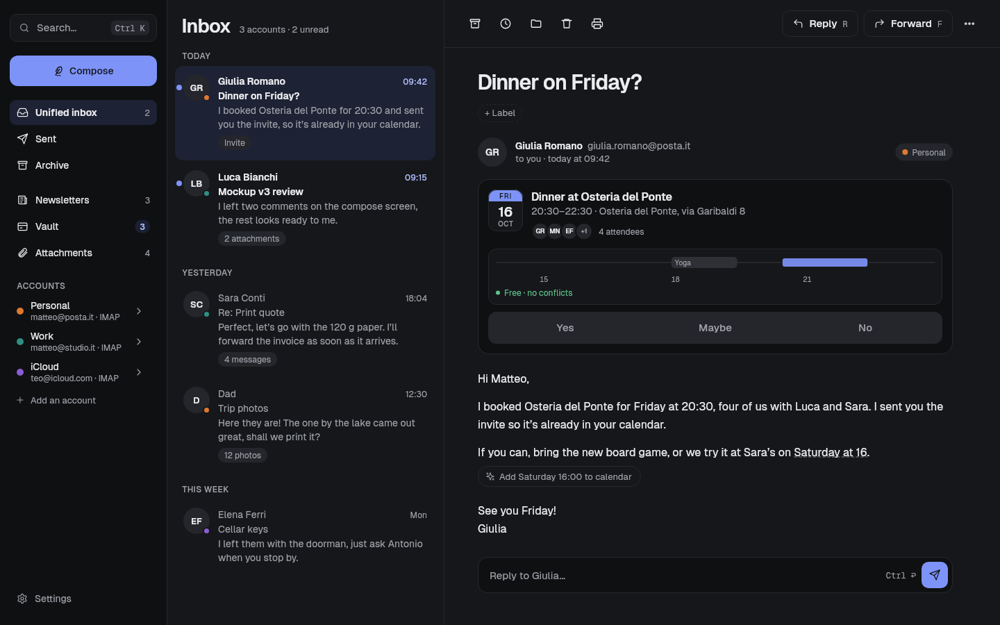
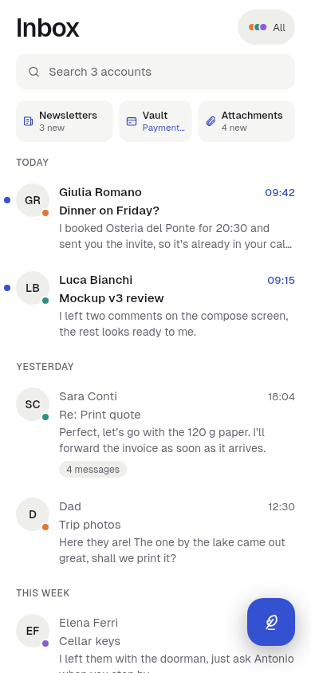
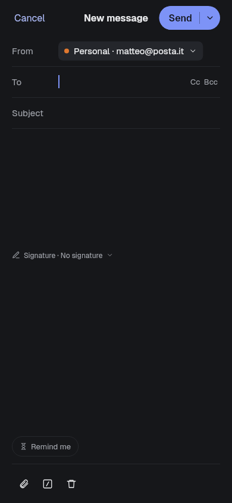

<p align="center">
  
</p>

# Piuma Mail

**Mail, made light.** A free, open-source email client with a clean, minimal interface. A quieter place to read, write and find your mail, with direct connections to your mailbox.

> [!NOTE]
> **In active development, not a stable release.** Mail protocols and the main interface flows are in the code; provider and platform coverage still need validation. Betas are for trying it out with a test mailbox. See [current status](#current-status).

[Download](#download) · [Screenshots](#screenshots) · [Current status](#current-status) · [Build from source](#build-from-source) · [Contribute](#contribute) · [License](#license)

## A quieter place for your mail

- **One place to read.** A unified inbox, conversations, search and a reading pane that adapts to desktop and phone layouts.
- **Room to focus.** Light and dark themes, considered typography and motion, with separate views for newsletters, attachments and the Vault.
- **Your mailbox, directly.** IMAP/SMTP and JMAP implementations connect to mail providers without a Piuma-operated mail proxy. Optional reports use a separate feedback relay.
- **Free software.** The aim is a free client without paid account tiers, with source you can inspect and contribute to.

## Download

Beta builds are published as GitHub prereleases, tagged `v0.1.0-beta.N`, on the **[Releases page](https://github.com/piuma-mail/piuma-mail/releases)**. Pick the newest entry marked *Pre-release*.

| Platform | File | Notes |
|---|---|---|
| Windows | `PiumaMail-win-Setup.exe` | Installer. The installed app checks the GitHub prereleases and updates itself. The build is not code-signed, so Windows SmartScreen shows a warning on first run. |
| Android | `PiumaMail-android-arm64.apk` | 64-bit ARM phones. Signed with the project's beta key, so each beta installs over the previous one. |
| macOS, Linux, iOS | — | No builds yet: [build from source](#build-from-source). |

To keep the Android app up to date, add this repository to [Obtainium](https://github.com/ImranR98/Obtainium) and turn on **Include prereleases**; otherwise download each new APK by hand.

Betas are built by the manual "Release" workflow ([`.github/workflows/release.yml`](.github/workflows/release.yml)) from `main`. It is beta software: try it with a test mailbox before relying on it.

## Screenshots

Golden screenshots from the app's test suite, using **fictional demo mail**. [Sources and capture notes](docs/images/README.md).

<p align="center">
  
  <br><sub>Desktop · inbox and reading, light theme</sub>
</p>

<details>
<summary>See the desktop in dark mode</summary>

<p align="center">
  
</p>

</details>

<table>
  <tr>
    <td align="center"></td>
    <td align="center"></td>
  </tr>
  <tr>
    <td align="center">A shared inbox, sized for your phone</td>
    <td align="center">Space to write, in dark mode</td>
  </tr>
</table>

## Current status

**Source review: November 1, 2026.** This describes implementations in this repository, not a tested-provider list. Many screens in the maintainer's mockup map are still marked *In progress*.

| Area | Present in the source | Limits and next steps |
|---|---|---|
| Mail connections | IMAP/SMTP, JMAP, account discovery and manual setup | Validate real-provider behavior; do not assume every provider or authentication method works |
| Everyday mail | Unified inbox, reading, composing, drafts, attachments, search, archive and Undo | Core flows remain in development; test with a disposable mailbox before relying on them |
| Organization | Newsletters, Vault, labels, snooze and attachment views | Coverage varies by feature and provider |
| Certified mail (PEC) | Provider presets and receipt handling | Implementation exists; no claim of comprehensive provider validation |
| Platforms | Windows, macOS, Linux, Android and iOS projects; desktop, phone and tablet layouts | Beta builds exist for Windows and Android only; the others are build-from-source, and iPhone/iPad readiness is not claimed |
| Updates | The Windows app updates itself from GitHub prereleases | Android updates come from a new APK (by hand or through Obtainium) |
| Wear OS | A small watch app ([`wear/`](wear/)) that shows the inbox sent by the phone app | No watch build is published |
| Microsoft 365 / Proton | Dedicated Graph and Bridge flows deferred | Not advertised as available integrations |
| Optional companion | A future direction for instant iPhone notifications and reliable sending while the app is closed | Not an available service or a current dependency |

## Build from source

For developers exploring the current code. Install Flutter and Rust plus the tools for your target platform; see [build prerequisites](CONTRIBUTING.md#building-the-app). The current CI configuration specifies Flutter 3.47.7.

```sh
# From the repository root: engine tests
cargo test

# App: resolve packages, then run on an available device
cd app
flutter pub get
flutter run
```

Use a test mailbox for development. Platform build instructions and the full validation commands are in [CONTRIBUTING.md](CONTRIBUTING.md); release scripts are not needed for a local run.

## Contribute

Start with a small, concrete improvement: a reproducible bug, a clearer setup guide, a provider compatibility finding, or an accessibility issue.

- **Report a problem or an idea from the app:** **Settings → Help & feedback** shows exactly what will be sent before sending it (the screenshot is off by default). Reports go to a private tracker through the [report relay](relay/README.md); no GitHub account is needed.
- **Open an issue here** for anything you are happy to discuss in public. Include the platform, build or commit, steps and expected behavior. Use invented messages and redact personal information from screenshots and logs.
- **Security problems:** do not open a public issue; see [SECURITY.md](SECURITY.md).
- **Code or documentation:** work on a branch, open a draft PR and sign off every commit with `git commit -s` for the [Developer Certificate of Origin](DCO.txt). Report the checks you actually ran. Read [CONTRIBUTING.md](CONTRIBUTING.md) before changing the app; UI changes require mockup alignment and approval.

## Inside the repository

| Folder | Purpose |
|---|---|
| [`core/`](core/) | Rust mail engine, synchronization, SQLite storage and search |
| [`app/`](app/) | Flutter interface and engine bridge |
| [`design/`](design/) | `tokens.json`, the single source for colors, fonts, shapes and motion |
| [`wear/`](wear/) | Wear OS watch app, fed by the phone app |
| [`relay/`](relay/) | Optional in-app report delivery, separate from mailbox traffic |
| [`tools/`](tools/) | Development and asset generation scripts |
| [`docs/`](docs/) | Presentation assets and where they come from ([notes](docs/images/README.md)) |

Style comes from [`design/tokens.json`](design/tokens.json). The mockups define design; the app defines behavior. [Keep them in sync](CONTRIBUTING.md#mockup-and-app-always-in-sync).

## How this was built

Piuma Mail is AI-assisted: Matteo directs the product and design and decides what to accept; coding agents help with code and documentation.

## License

[GPL-3.0-or-later](LICENSE), with an additional permission for app store distribution under GPL section 7: [LICENSE-APPSTORE.md](LICENSE-APPSTORE.md). Third-party components and licenses: [THIRD_PARTY.md](THIRD_PARTY.md).
